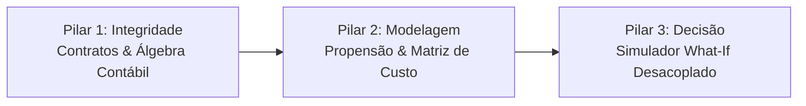

# E-Commerce Sales & Customer Analytics

[](https://github.com/talesgomes27/ecommerce_sales_customer_analytics/actions/workflows/ci.yml)
[](https://github.com/talesgomes27/ecommerce_sales_customer_analytics/actions/workflows/publish.yml)
[](https://ecommerce-sales-customer-analytics.streamlit.app/)
[](https://www.python.org/)
[](https://github.com/astral-sh/uv)
[](https://github.com/astral-sh/ruff)
[](tests/)

Plataforma de inteligência de vendas, diagnóstico de margem de contribuição e simulação de cenários operacionais para comércio eletrônico. Integra auditoria rigorosa de contratos de dados, modelagem de propensão com calibração orientada a custo financeiro e um motor de simulação de decisões desacoplado da interface gráfica.

[📊 Relatório Executivo Interativo (Quarto)](https://talesgomes27.github.io/ecommerce_sales_customer_analytics/) &nbsp;|&nbsp; [🎛️ Simulador What-If (Streamlit Cloud)](https://ecommerce-sales-customer-analytics.streamlit.app/)

---

## Sumário Executivo do Negócio

A análise compreende o histórico integral de **138.116 transações** realizadas entre 2021 e 2025 por **24.911 clientes**, totalizando **\$177,13 milhões em faturamento bruto** e **\$76,15 milhões em lucro contábil** (ticket médio de \$1.282,50). 

Apesar do crescimento consistente de volume, a rentabilidade é corroída por distorções de incentivo comercial. A questão norteadora deste projeto responde diretamente à liderança de precificação e operações:

> **"A que nível de desconto o ganho marginal de volume deixa de compensar e a margem de contribuição passa a ser destruída por custos operacionais e risco de devolução?"**

A auditoria dos dados revelou **1.296 transações deficitárias** no histórico, gerando prejuízo acumulado de **\$201.225,34**, concentradas quase em sua totalidade em descontos superiores a 35%. Além disso, prazos de entrega elevados elevam significativamente o atrito com o consumidor, com impacto direto na taxa de cancelamento (média de 6,08%) e devolução (média de 6,85%).

---

## Pilares da Solução



### 1. Auditoria Contratual e Integridade Temporal
* **Contratos Estritos de Esquema:** Validação de tipos, unicidade de `Order_ID` e intervalos físicos via Pandera sobre Polars.
* **Álgebra Contábil Auditada:** Verificação determinística da equação de receita líquida ($\text{Preço Bruto} - \text{Desconto} = \text{Receita Líquida}$) e do lucro unitário, impedindo incongruências contábeis.
* **Split Temporal Point-in-Time:** Divisão de treino e teste estritamente cronológica (Out-of-Time). Cálculos de Recência, Frequência e Valor Monetário (RFM) computados exclusivamente no passado para prevenir vazamento temporal (*lookahead bias*).

### 2. Modelagem Preditiva e Minimização de Custos
* **Segmentação Comportamental (RFM):** Clusterização k-means identificando coortes de valor, desde campeões de recompra até clientes de alto valor em risco de churn (*At-Risk High-Value*).
* **Modelos de Propensão com Ajuste de Threshold:** Classificadores LightGBM e XGBoost avaliados no contexto de checkout. Otimização do ponto de corte de decisão ($\tau^* = 0,55$) calibrada contra a matriz de perdas financeiras (custo do falso negativo vs. custo do falso positivo), superando a acurácia ingênua.
* **Sensibilidade de Elasticidade:** Quantificação da elasticidade de demanda em faixas de desconto, mapeando o limiar em que a elasticidade torna-se inelástica à margem.

### 3. Apoio à Decisão: Simulador What-If Desacoplado
* **Motor de Cálculo Puro (`src/core/`):** Implementação sem frameworks de UI, sustentada exclusivamente em Pydantic v2 e NumPy/Pandas.
* **Provisão Dinâmica de Risco Operacional:** Incorporação de probabilidade condicional de devolução e cancelamento calibrada pelo prazo de entrega prometido (`Delivery_Days`) e faixa de desconto.
* **Análise de Break-Even:** Cálculo instantâneo do ponto de equilíbrio $\text{Desconto}^*$ no qual a margem de contribuição unitária é reduzida a zero após custos mercantis, tributários, de frete e reversos.

---

## Indicadores Consolidados da Operação

| Métrica Auditada | Valor Histórico | Contexto Operacional |
| :--- | :--- | :--- |
| **Volume de Pedidos** | `138.116` | Período de 5 anos (2021-01-01 a 2025-12-31) |
| **Base de Clientes Únicos** | `24.911` | Clientes com identificadores normalizados |
| **Faturamento Bruto (GMV)** | `\$177.134.263,74` | Receita total acumulada |
| **Lucro Bruto Operacional** | `\$76.146.395,76` | Margem agregada do catálogo |
| **Ticket Médio (AOV)** | `\$1.282,50` | Média ponderada por pedido |
| **Avaliação Média dos Clientes** | `3,68 / 5,00` | Escala de satisfação declarada |
| **Taxa Média de Devolução** | `6,85%` | Impacto em logística reversa e perdas de estoque |
| **Taxa Média de Cancelamento** | `6,08%` | Fricção operacional pré-entrega |
| **Transações Deficitárias** | `1.296 pedidos` | **\$201.225,34** em prejuízo por desconto excessivo (>35%) |

---

## Arquitetura da Solução

O projeto segue princípios de **Clean Architecture** e responsabilidade única. O núcleo de regras de negócio (`src/core/`) opera isolado de qualquer biblioteca de renderização ou framework web:

```text
ecommerce_sales_customer_analytics/
├── .github/workflows/          # Automação de CI/CD (GitHub Actions)
│   ├── ci.yml                  # Linting (Ruff) e testes unitários (Pytest)
│   └── publish.yml             # Compilação e deploy do Quarto para GitHub Pages
├── data/                       # Armazenamento local de dados (ignorado no Git)
│   └── raw/                    # Tabelas analíticas e estatísticas canônicas
├── docs/                       # Especificações arquiteturais e relatórios técnicos
│   ├── adr/                    # Architecture Decision Records
│   └── 01-data-discovery-...   # Contratos, PRD e convenções do projeto
├── src/                        # Código-fonte modular da biblioteca
│   ├── core/                   # Domínio puro: schemas Pydantic v2 e motor do simulador
│   │   ├── schemas.py          # Enums de canal, categoria, tier e modelos de entrada/saída
│   │   └── simulator.py        # BusinessScenarioSimulator, break-even e curvas de margem
│   ├── data/                   # Ingestão de dados e contratos de schema Pandera
│   ├── evaluation/             # Métricas analíticas e tabelas executivas Great Tables
│   ├── features/               # Engenharia de atributos point-in-time e cálculo RFM
│   ├── models/                 # Modelos de classificação, clustering e elasticidade
│   └── ui/                     # Componentes visuais e gráficos interativos Plotly
├── tests/                      # Suíte de 34 testes automatizados (Pytest)
│   ├── test_contracts.py       # Validação de integridade de dados e álgebra contábil
│   ├── test_features.py        # Testes de separação temporal e ausência de lookahead
│   ├── test_models.py          # Testes de clustering RFM e treino de classificadores
│   ├── test_simulator.py       # Testes unitários do motor What-If e break-even
│   ├── test_tables.py          # Validação de renderização de tabelas executivas
│   └── test_ui.py              # Testes de geração de gráficos e visualizações
├── app.py                      # Aplicação web executiva (Streamlit What-If Dashboard)
├── index.qmd                   # Relatório técnico-executivo compilável (Quarto)
├── justfile                    # Automação de comandos do ambiente local
└── pyproject.toml              # Declaração canônica de dependências (PEP 621 via uv)
```

### Decisões Arquiteturais Chave
1. **Zero Acoplamento no Domínio:** `src/core/` não importa Streamlit, Plotly ou Matplotlib. Pode ser importado diretamente por workers assíncronos, APIs REST (FastAPI) ou rotinas de batch.
2. **Contratos Imutáveis e Validados:** Tipos, limites físicos (ex.: descontos restritos a `[0.0, 0.90]`) e valores categóricos são validados em tempo de execução via Pydantic v2.
3. **Padrão de Ferramental Moderno:** Gestão estrita via `uv`, eliminando arquivos legados de ambiente (`requirements.txt`, `conda.yaml`) em favor do `pyproject.toml`.

---

## Stack Tecnológica

| Camada / Função | Tecnologias Utilizadas |
| :--- | :--- |
| **Gerenciador de Pacotes e Runtimes** | `uv` (Astral) |
| **Linguagem Base** | `Python 3.12+` |
| **Processamento e Álgebra Contábil** | `Polars`, `Pandas`, `NumPy` |
| **Contratos e Validação de Esquema** | `Pandera (Polars)`, `Pydantic v2` |
| **Machine Learning & Estatística** | `LightGBM`, `XGBoost`, `Scikit-Learn`, `SciPy`, `Statsmodels` |
| **Motor de Apresentação e Relatório** | `Quarto CLI`, `Great Tables` |
| **Interface Interativa & Gráficos** | `Streamlit`, `Plotly` |
| **Qualidade de Código & Testes** | `Pytest`, `Pytest-Cov`, `Ruff` |
| **Orquestração de Tarefas Locais** | `Just` (`rust-just`) |
| **Integração e Entrega Contínua** | `GitHub Actions` (`ci.yml`, `publish.yml`) |

---

## Guia Rápido de Execução

### 1. Pré-requisitos
Certifique-se de possuir o gerenciador `uv` instalado em seu sistema:
```bash
curl -LsSf https://astral.sh/uv/install.sh | sh
```

### 2. Instalação do Ambiente
Clone o repositório e sincronize o ambiente virtual isolado:
```bash
git clone git@github.com:talesgomes27/ecommerce_sales_customer_analytics.git
cd ecommerce_sales_customer_analytics
uv run just setup
```

### 3. Executando o Simulador What-If (Dashboard Interativo)
O simulador interativo está publicado e disponível publicamente em:
👉 **[ecommerce-sales-customer-analytics.streamlit.app](https://ecommerce-sales-customer-analytics.streamlit.app/)**

Para executar a aplicação localmente:
```bash
uv run streamlit run app.py
```
Acesse a aplicação no navegador em `http://localhost:8501` para manipular parâmetros de desconto, volume, canal e custos logísticos com sensibilidade em tempo real.

### 4. Compilação do Relatório Executivo (Quarto)
Para visualizar ou compilar o relatório analítico:
```bash
# Servidor local com recarregamento em tempo real
uv run just serve

# Ou compilação manual para HTML estático
quarto render index.qmd --to html
```

### 5. Qualidade e Testes Automatizados
O projeto conta com comandos consolidados via `just`:
```bash
# Executa linter e bateria de 34 testes unitários
uv run just check

# Executa testes em modo detalhado
uv run just test

# Formatação e autocorreção de linter
uv run just format
```

---

## Governança, CI/CD e Qualidade de Código

A integridade do repositório é garantida por dois fluxos automatizados no GitHub Actions:
* **Integração Contínua (`ci.yml`):** Acionada a cada `push` ou `pull request` para a branch `main`. Executa checagem de estilo e formatação com `ruff` e roda os 34 testes unitários com cobertura de contratos de dados, separação temporal de atributos, modelos preditivos, tabelas de diagnóstico e simulação de cenários.
* **Publicação Contínua (`publish.yml`):** Compila o documento Quarto de ponta a ponta e publica o relatório estático no branch `gh-pages`.

---

## Licença
Distribuído sob a licença MIT. Consulte `LICENSE` para mais detalhes.
