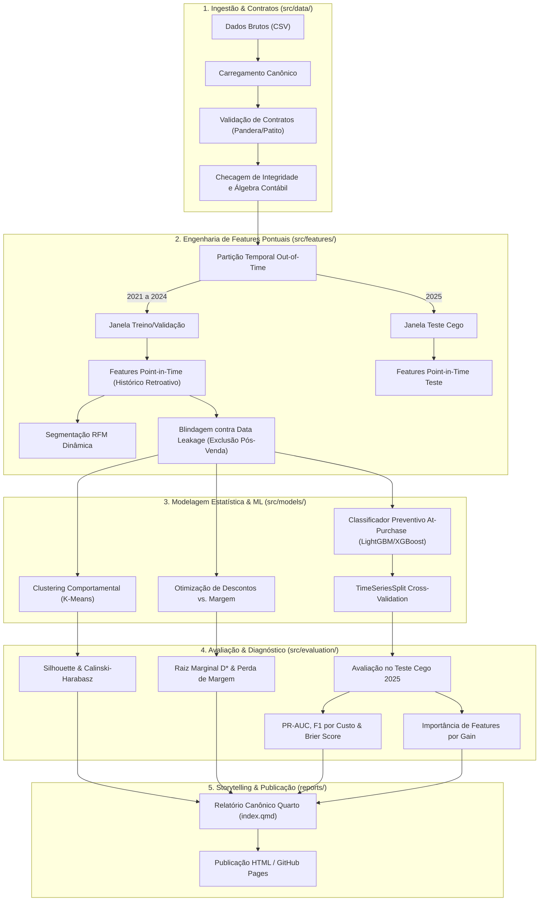

# Gate 3: Arquitetura do Pipeline, Engenharia de Features e Storyboard Quarto

**Projeto:** `ecommerce_sales_customer_analytics`  
**Data:** 2026-10-16  
**Arquétipo:** A (Data Science, Analytics & ML — CRISP-ML(Q) + Data Storytelling)  
**Status do Portão:** Elaborado para validação humana  

---

## 1. Topologia Geral do Pipeline Analítico

O pipeline estrutura o ciclo de dados em 5 módulos sequenciais desacoplados, implementados no pacote `src/` e integrados ao relatório Quarto.



---

## 2. Arquitetura das Etapas CRISP-ML(Q)

### 2.1. Ingestão e Contratos (*Data Understanding / Prepare*)
- **Módulo:** `src/data/loader.py` e `src/data/contracts.py`.
- **Entrada:** `ecommerce_sales_customer_analytics_150k.csv` (138.116 linhas), `customer_master.csv`, `product_catalog.csv`.
- **Validação Automatizada:** Execução de schema Pandera garantindo tipos, unicidade de `order_id` e checagem contábil:
  $$|\text{net\_sales} - (\text{gross\_sales} - \text{discount\_amount} + \text{tax\_amount} + \text{shipping\_cost})| < 0,01$$
- **Saída:** DataFrame canônico limpo pronto para processamento.

### 2.2. Engenharia de Features Pontuais (*Data Prep & EDA / Process*)
- **Módulo:** `src/features/builder.py` e `src/features/rfm.py`.
- **Isolamento de Vazamento Temporal:** Reconstrução cumulativa de métricas do cliente:
  - `orders_count_prior`: contagem de pedidos efetuados pelo cliente estritamente antes da data do pedido atual.
  - `spend_prior`: valor monetário acumulado pelo cliente até a data do pedido anterior.
  - `days_since_last_order`: intervalo em dias desde a última compra.
- **RFM Dinâmico:** Padronização robusta de Recência, Frequência e Valor para segmentação.
- **Isolamento de Pós-Venda:** Descarte programático de `delivery_days`, `estimated_delivery_days`, `customer_rating`, `review_sentiment`, `customer_review`, `return_status`, `return_reason`, e mapeamento sanitizado de `payment_status` (transformando em binário pré-autorização se aplicável).

### 2.3. Modelagem Estatística e Machine Learning (*Modeling / Construct*)
- **Módulo:** `src/models/train.py`, `src/models/clustering.py`, `src/models/pricing.py`.
- **Modelagem 1: Segmentação de Clientes:** K-Means sobre features RFM padronizadas com seleção de $K \in [3, 5]$ baseada em Silhouette Score e interpretação econômica dos centroides.
- **Modelagem 2: Elasticidade de Margem e Preço:** Ajuste de curvas de regressão polinomial e segmentada (Splines) entre `discount_percentage` e `profit_margin`, computando analiticamente o ponto de inflexão crítico $D^*$ onde $\frac{\partial \text{Profit}}{\partial D} = 0$.
- **Modelagem 3: Classificador Preventivo At-Purchase:**
  - *Baseline:* Regressão Logística com pesos balanceados (`class_weight='balanced'`).
  - *Modelos Candidatos:* LightGBM e XGBoost treinados em 2021-2024 com validação em 4 blocos temporais (*TimeSeriesSplit*).
  - *Alvo Supervisionado:* Pedido desfavorável prévio (`is_unfavorable = (order_status in ['Returned', 'Cancelled'])`).

### 2.4. Avaliação, Diagnóstico e Explicabilidade (*Evaluation / Share*)
- **Módulo:** `src/evaluation/metrics.py`.
- **Avaliação Cega (Teste 2025):** 27.598 transações do ano de 2025 avaliadas sem refit.
- **Métricas:** PR-AUC primária, curva ROC-AUC secundária, calibração via Brier Score e matriz de confusão ajustada ao custo de intervenção preventiva.
- **Explicabilidade:** Importância das variáveis calculada estritamente por **`gain`** (`importance_type='gain'`) para refletir a redução factual da perda logarítmica.

### 2.5. Recomendações Executivas e Ação (*Deployment / Act*)
- **Módulo:** `reports/index.qmd` compilado via Quarto CLI.
- Tradução de métricas técnicas em políticas de negócio acionáveis:
  1. *Pricing:* Política de teto de descontos parametrizada por categoria para erradicar as 1.296 vendas com prejuízo.
  2. *CRM:* Ações de reativação para clientes no cluster "Em Risco" identificados pelo RFM.
  3. *Operações:* Alerta preditivo no checkout para pedidos com score de devolução elevado, sugerindo confirmação ativa de endereço e checagem de tamanho.

---

## 3. Storyboard Visual do Relatório Quarto

O storyboard define a especificação exata de cada visualização editorial, em conformidade estrita com o `quarto-quality-checklist.md`.

```
+---------------------------------------------------------------------------------------------------+
| FIG-01: Painel Duplo de Pricing e Margem (Aspect Ratio 1:1, DPI 300)                              |
| [ Painel (a): Scatter + Tendência Spline ]    | [ Painel (b): Distribuição de Prejuízo (KDE) ]    |
| - Eixo X: Desconto Concedido (%)              | - Eixo X: Margem de Lucro Negativa (%)           |
| - Eixo Y: Margem de Lucro Real (%)            | - Eixo Y: Densidade de Frequência                |
| - Linha D*: Ponto de Inflexão (Margem = 0)    | - Anotação: 1.296 pedidos (0,94% do faturamento) |
+---------------------------------------------------------------------------------------------------+
| FIG-02: Retorno sobre Aquisição LTV / CAC por Canal de Marketing                                  |
| - Barras horizontais ordenadas por razão LTV / CAC                                                |
| - Rótulos diretos: CAC médio ($) e Receita líquida média ($)                                      |
+---------------------------------------------------------------------------------------------------+
| FIG-03: Painel de Segmentação RFM e Concentração de Valor                                         |
| [ Painel (a): Projeção PCA / UMAP Clusters ]  | [ Painel (b): Curva de Pareto de Faturamento ]    |
| - Cores: 4 Clusters Comportamentais           | - Eixo X: % acumulado de clientes                 |
| - Centroides identificados                    | - Eixo Y: % acumulado de receita líquida          |
+---------------------------------------------------------------------------------------------------+
| FIG-04: Curva Precision-Recall (PR-AUC) e Importância por Ganho (At-Purchase)                     |
| [ Painel (a): Curva PR (Baseline vs. LightGBM)]| [ Painel (b): Top 10 Features por Gain ]          |
| - Linha base horizontal (Taxa Base = 12,93%)  | - Barras ordenadas por importância factual       |
| - Ponto ótimo: Limiar de Custo Minimo (Tau*)  | - Anotações de ganho de redução de erro           |
+---------------------------------------------------------------------------------------------------+
| FIG-05: Impacto de Atrasos Logísticos na Satisfação (customer_rating)                             |
| - Boxplot pareado: No Prazo vs. Atrasado                                                          |
| - Indicação de média e p-valor do teste Mann-Whitney                                              |
+---------------------------------------------------------------------------------------------------+
```

### Especificação Técnica das Figuras
1. **Painéis Pareados:** Todos os gráficos de dois eixos lado a lado são construídos via:
   ```python
   fig, axes = plt.subplots(1, 2, figsize=(12, 5.2), constrained_layout=True)
   for ax in axes:
       ax.set_box_aspect(1)
       sns.despine(ax=ax)
   ```
2. **Resolução Editorial:** Configuração global em Quarto `dpi=300`, com exportação de cópias estáticas para `reports/figures/`.
3. **Cores e Contraste:** Paleta corporativa sóbria (tons de azul-marinho, grafite e destaque em terracota para perdas/prejuízos), sem saturação excessiva e acessível para daltonismo.

---

## 4. Registro de Decisões Arquiteturais (ADRs)

As decisões estruturantes do projeto foram formalizadas em documentos dedicados em `docs/adr/`:

- [**ADR 0001: Arquitetura Modular de Pipeline Analítico e Engenharia de Features Pontuais**](file:///home/tales/Documentos/github/ecommerce_sales_customer_analytics/docs/adr/0001-pipeline-and-feature-store-architecture.md)
  - Aborda o desacoplamento em módulos em `src/`, a validação de contratos contábeis e a blindagem contra vazamento temporal através de features *point-in-time*.
- [**ADR 0002: Estratégia de Modelagem, Algoritmos Candidatos e Métricas de Avaliação**](file:///home/tales/Documentos/github/ecommerce_sales_customer_analytics/docs/adr/0002-modelling-and-evaluation-strategy.md)
  - Aborda o split *Out-of-Time* (2021-2024 vs. 2025), a métrica primária PR-AUC com calibração de corte por custo e a utilização estrita de importância por ganho (`gain`).
- [**ADR 0003: Governança Editorial Quarto e Padrão Canônico de Storytelling**](file:///home/tales/Documentos/github/ecommerce_sales_customer_analytics/docs/adr/0003-quarto-storytelling-and-publication-standard.md)
  - Aborda a configuração do Quarto em 6 seções CRISP-ML(Q), `lang: pt-BR`, `freeze: auto`, sem numeração manual nos títulos e regras visuais de subplots pareados (`set_box_aspect(1)`).
