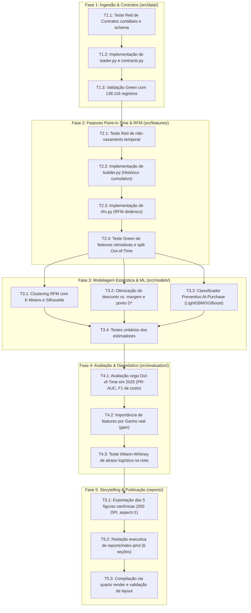

# Gate 5: Plano de Implementação, Validação e Critérios de Aceite

**Projeto:** `ecommerce_sales_customer_analytics`  
**Data:** 2026-10-16  
**Arquétipo:** A (Data Science, Analytics & ML — CRISP-ML(Q) + Data Storytelling)  
**Status do Portão:** Elaborado para validação humana  

---

## 1. Grafo de Precedência Técnica (DAG de Tarefas)

A implementação segue um fluxo estritamente incremental orientado a testes (TDD e Data Contracts). Nenhuma etapa posterior pode ser iniciada sem que os testes automatizados da fase anterior estejam em verde.



---

## 2. Checklist Atômico e Sequencial de Implementação

### Fase 1: Ingestão, Sanitização e Validação de Contratos
- [ ] **Tarefa 1.1:** Criar `tests/test_contracts.py` definindo os testes de integridade contábil:
  - Verificar se `net_sales == gross_sales - discount_amount + tax_amount + shipping_cost` (tolerância 0,01).
  - Verificar se `profit == net_sales - shipping_cost - product_cost` (tolerância 0,01).
  - Verificar unicidade de `order_id` (138.116 registros únicos).
  - *Comando:* `uv run pytest tests/test_contracts.py` (deve falhar — Red).
- [ ] **Tarefa 1.2:** Implementar `src/data/contracts.py` com o schema Pandera/Polars estrito descrito em `docs/01-data-discovery-and-contracts.md`.
- [ ] **Tarefa 1.3:** Implementar `src/data/loader.py` com funções determinísticas de carregamento e tipagem para as fontes canônicas.
- [ ] **Tarefa 1.4:** Executar validação completa: `uv run pytest tests/test_contracts.py` (deve passar — Green).

### Fase 2: Engenharia de Features Pontuais e Blindagem contra Leakage
- [ ] **Tarefa 2.1:** Criar `tests/test_features.py` testando a fronteira temporal:
  - Garantir que para qualquer pedido na data $t$, as métricas de cliente (`orders_count_prior`, `spend_prior`) não utilizem transações $\ge t$.
  - Garantir ausência total de colunas proibidas de pós-venda na matriz preditiva.
- [ ] **Tarefa 2.2:** Implementar `src/features/builder.py`:
  - Cálculo vetorizado cumulativo de histórico por cliente e categoria.
  - Particionamento temporal estrito: Treino/Validação (2021 a 2024) e Teste Cego (2025).
- [ ] **Tarefa 2.3:** Implementar `src/features/rfm.py`:
  - Cálculo dinâmico de Recência (dias desde a última compra), Frequência e Valor acumulado.
- [ ] **Tarefa 2.4:** Executar verificação automatizada: `uv run pytest tests/test_features.py` (Green).

### Fase 3: Modelagem Estatística e Machine Learning
- [ ] **Tarefa 3.1:** Implementar `src/models/clustering.py`:
  - Ajuste de K-Means sobre RFM com escalonamento robusto, varredura de $K \in [3, 5]$ e cálculo de Silhouette Score.
- [ ] **Tarefa 3.2:** Implementar `src/models/pricing.py`:
  - Ajuste de regressão polinomial/splines entre percentual de desconto e margem percentual real.
  - Cálculo numérico da raiz $D^*$ onde $\frac{\partial \text{Profit}}{\partial D} = 0$.
- [ ] **Tarefa 3.3:** Implementar `src/models/train.py`:
  - Treinamento de Baseline (Regressão Logística balanceada) e Modelos de Árvore (LightGBM/XGBoost) com validação *TimeSeriesSplit* em 4 folds temporais.
- [ ] **Tarefa 3.4:** Criar `tests/test_models.py` validando convergência, ausência de NaN nas predições e cálculo de probabilidades calibradas no intervalo $[0, 1]$.

### Fase 4: Avaliação, Diagnóstico e Explicabilidade
- [ ] **Tarefa 4.1:** Implementar `src/evaluation/metrics.py`:
  - Avaliação no conjunto cego de teste de 2025: cálculo de PR-AUC, ROC-AUC, Brier Score e F1 ótimo ponderado pela matriz de custos.
- [ ] **Tarefa 4.2:** Implementar rotina de explicabilidade e importância por ganho:
  - Extração estrita de `importance_type='gain'` para os modelos de árvore, tabulando os top 10 preditores de cancelamento/devolução.
- [ ] **Tarefa 4.3:** Implementar teste estatístico de hipóteses:
  - Teste de Mann-Whitney U comparando avaliações de entregas no prazo versus atrasadas ($H_5$).
- [ ] **Tarefa 4.4:** Criar `tests/test_evaluation.py` e rodar: `uv run pytest tests/test_evaluation.py`.

### Fase 5: Data Storytelling e Relatório Executivo Quarto
- [ ] **Tarefa 5.1:** Implementar script gerador de gráficos editoriais (`src/evaluation/plots.py`):
  - Gerar as 5 figuras canônicas descritas no storyboard (`docs/03-architecture-and-schema.md`).
  - Aplicar `fig, axes = plt.subplots(1, 2, figsize=(12, 5.2), constrained_layout=True)`, `ax.set_box_aspect(1)`, `sns.despine()` e salvar em `reports/figures/` com `dpi=300`.
- [ ] **Tarefa 5.2:** Redigir o conteúdo analítico completo em `reports/index.qmd`:
  - Preencher as 6 seções canônicas com a narrativa anti-IA, tabelas quantitativas, figuras em alta resolução e callouts executivos.
- [ ] **Tarefa 5.3:** Compilação final:
  - Executar `/usr/local/bin/quarto render` e verificar ausência de erros de build, formatação visual limpa e links funcionando.

---

## 3. Comandos de Verificação Automatizada

Toda a suíte de verificação deve ser executada com os comandos padronizados abaixo:

```bash
# 1. Executar suíte completa de testes unitários e de contratos
uv run pytest tests/ -v

# 2. Análise estática de código e formatação limpa
uv run ruff check . --fix
uv run ruff format .

# 3. Renderização editorial do relatório Quarto
/usr/local/bin/quarto render reports/index.qmd
```

---

## 4. Critério de Aceite e Handoff

- **Critério de Parada:** Este plano detalha todas as etapas da implementação. Nenhuma linha de código de transformação ou modelagem pode ser escrita sem a aprovação explícita do desenvolvedor sobre este documento.
- **Handoff:** Após a aprovação formal do usuário:
  1. Todos os 5 Gates da `pre-code-pipeline` serão marcados como `[x] Aprovado` no `task.md`.
  2. O controle será transferido para a Meta-Skill **`execution-pipeline`**, iniciando a execução atômica da Fase 1 (Ingestão & Contratos) sob o ciclo TDD.
