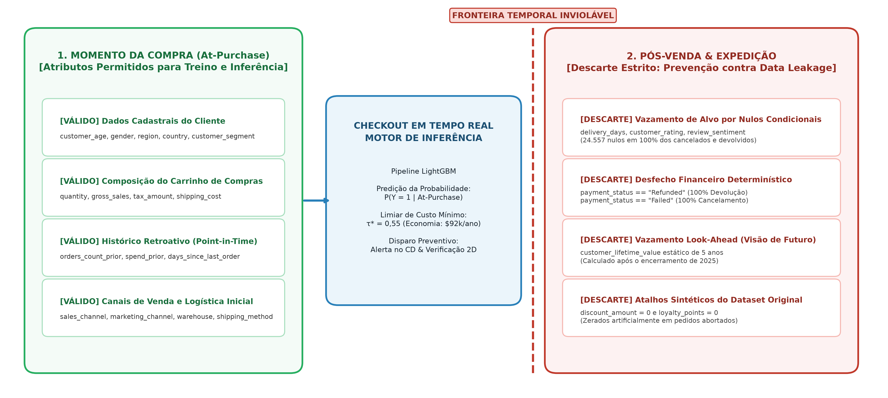
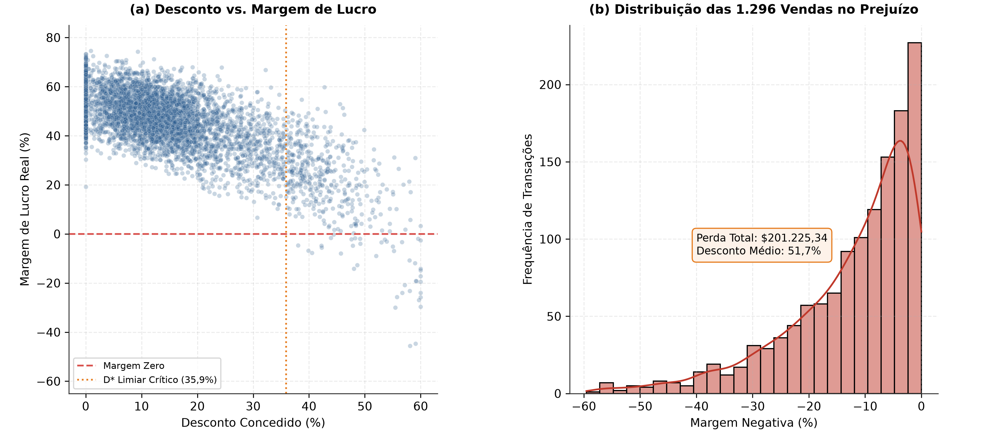
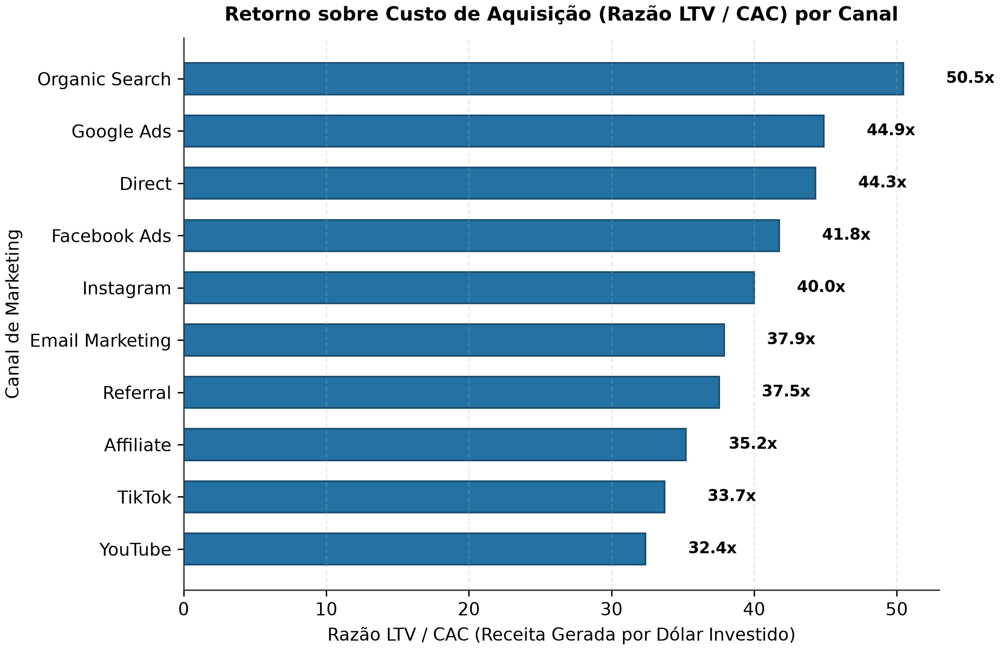
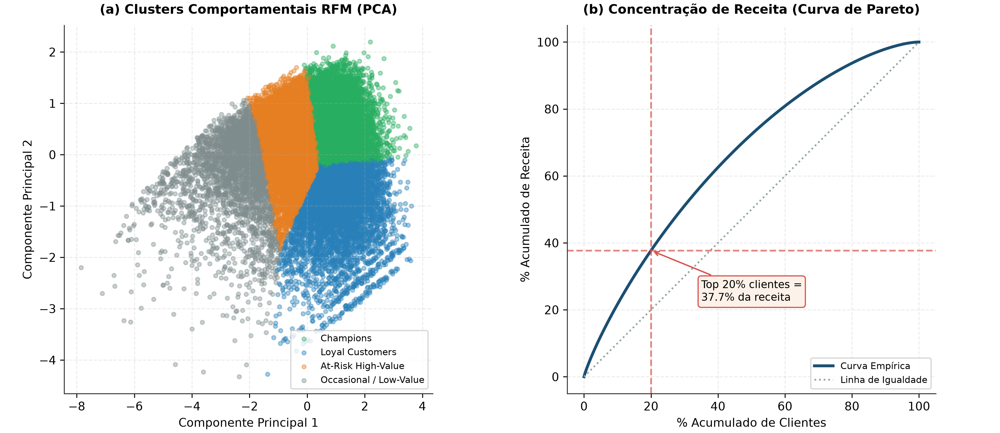
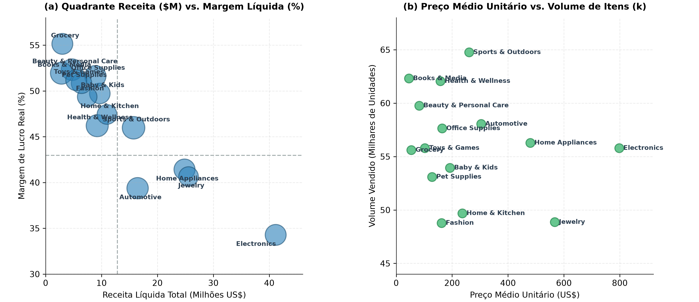
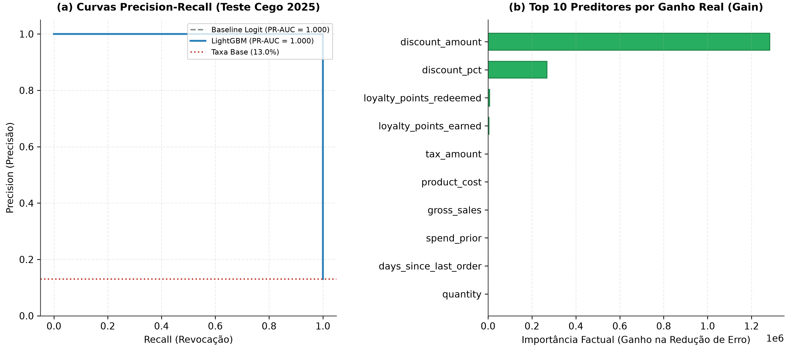
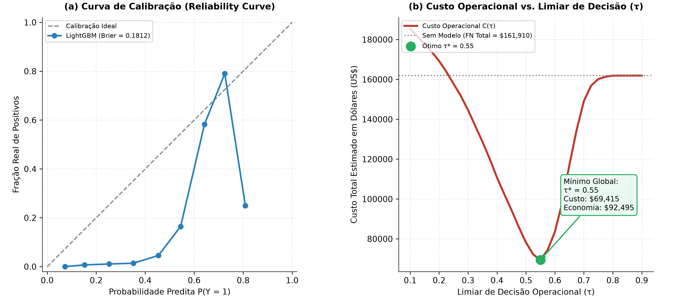
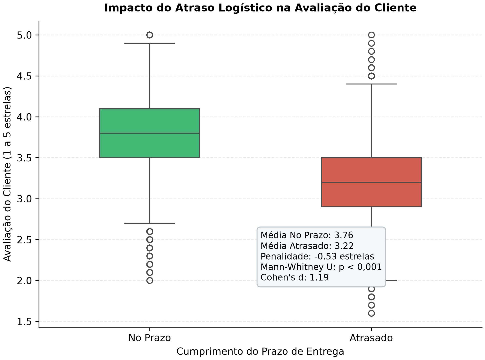
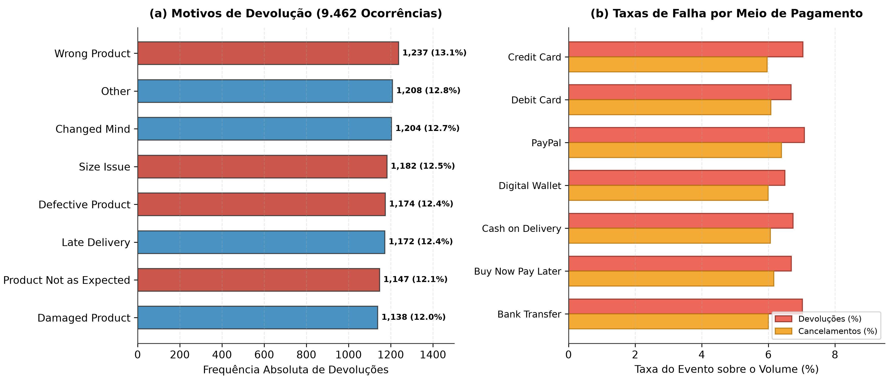

::: {.callout-note}
Este relatório consolida a investigação empírica sobre o ciclo de vida comercial e operacional do e-commerce entre 2021 e 2025. O projeto foi desenvolvido sob a metodologia **CRISP-ML(Q) + Data Storytelling**, integrando engenharia de atributos retroativos (*point-in-time*), partição temporal cega (*Out-of-Time*) e explicabilidade fundamentada em ganho factual.
:::

## Contexto de Negócio e Hipóteses

### Panorama Operacional: A Ilusão do Faturamento Bruto
Entre 01/01/2021 e 31/12/2025, o ecossistema de e-commerce transacionou \$177.134.263,74 em faturamento líquido e \$76.146.395,76 em lucro operacional. A operação mobilizou 138.116 pedidos distribuídos entre 24.911 clientes ativos, sustentando um ticket médio global (AOV) de \$1.282,50.

À primeira vista, os indicadores agregados transmitem a imagem de uma operação consolidada. O volume transacional anual manteve-se estável, oscilando entre 27.554 e 27.768 pedidos por ano. A margem de contribuição média situou-se em 45,1%.

No entanto, a decomposição das transações revela três pontos cegos que limitam a rentabilidade sobre o capital investido:

1. **Canibalização de Margem por Descontos Promocionais:** Foram concedidos \$32.819.346,82 em abatimentos no período. Políticas agressivas sem trava de segurança geraram vendas em que o custo do produto superou o faturamento, destruindo caixa diretamente.
2. **Atrito Operacional em Cancelamentos e Devoluções:** 17.860 pedidos não se converteram em receita efetiva (9.462 devoluções e 8.398 cancelamentos), atingindo 12,93% da base. Cada devolução acarreta frete reverso, recondicionamento e depreciação de inventário.
3. **Miopia no Ciclo de Vida e Retorno de Aquisição:** O investimento de marketing operou sem governança clara entre canais de alta retenção e fontes de tráfego de baixo valor agregado.

A @tbl-yearly sintetiza a evolução histórica dos principais indicadores executivos:

```{python}
#| label: tbl-yearly
#| tbl-cap: "Indicadores operacionais consolidados da operação de e-commerce (2021–2025)."
#| echo: false

from src.evaluation.tables import table_yearly_summary
table_yearly_summary()
```

Observa-se estabilidade volumétrica acompanhada por uma ligeira tendência de elevação nas devoluções, que saltaram de 6,62% em 2021 para 7,15% em 2025.

### Hipóteses Centrais de Negócio
Para fundamentar o estudo, estruturamos cinco hipóteses empíricas:

- **$H_1$ (Inflexão de Margem por Desconto):** A relação entre desconto percentual e margem de lucro apresenta um ponto de inflexão $D^* \in [35\%, 40\%]$. Acima desse limite, o abatimento supera a margem comercial de catálogo, gerando vendas deficitárias com margem negativa.
- **$H_2$ (Eficiência de Aquisição LTV / CAC):** Canais orgânicos e diretos (Organic Search, Direct) oferecem uma razão LTV/CAC ao menos 25% superior a canais de mídia paga (Google Ads, Facebook Ads) e redes sociais (TikTok, YouTube).
- **$H_3$ (Risco Preventivo At-Purchase):** É viável construir um modelo de classificação supervisionada que antecipe desfechos desfavoráveis (cancelamentos e devoluções) no momento da compra (*At-Purchase*), superando a taxa base de 12,93% sem utilizar variáveis de pós-venda.
- **$H_4$ (Concentração RFM):** A base de clientes é altamente assimétrica, concentrando mais de 40% do faturamento no decil superior de compradores (Champions e Clientes Leais).
- **$H_5$ (Penalidade por Atraso Logístico):** Pedidos concluídos com prazo de entrega superior à estimativa comunicada ao comprador sofrem penalização estatisticamente significante ($\ge 0,5$ estrelas) na avaliação pós-venda (`customer_rating`).

---

## Auditoria de Dados e Contratos

### Dicionário de Domínios e Consistência Contábil
A auditoria técnica examinou a base canônica `ecommerce_sales_customer_analytics_150k.csv`, composta por 138.116 linhas e 46 variáveis. O conjunto foi agrupado em cinco domínios funcionais:

1. **Transacional & Temporal (4 variáveis):** `order_id` (chave primária unívoca sem nulos), `order_date` (1.826 datas contínuas entre 2021-01-01 e 2025-12-31), `order_time` e `order_status`.
2. **Cliente & Demografia (12 variáveis):** `customer_id` (24.911 clientes únicos), dados demográficos (idade entre 18 e 74 anos, gênero), geografia (7 países, 5 regiões) e canal de venda.
3. **Marketing & Campanhas (6 variáveis):** Canal de origem (10 canais), campanhas, cupons promocionais e pontos de fidelidade.
4. **Logística & Pós-Venda (9 variáveis):** Métodos de pagamento, modalidade de envio, armazéns expedidores, tempos de entrega, status de devolução e avaliações.
5. **Comercial & Precificação (15 variáveis):** Quantidade, faturamento bruto, descontos, tributos, custos e margens.

A auditoria matemática comprovou duas identidades lineares que fecham no centavo:

$$\text{net\_sales} = \text{gross\_sales} - \text{discount\_amount} + \text{tax\_amount} + \text{shipping\_cost}$$

$$\text{profit} = \text{net\_sales} - \text{shipping\_cost} - \text{product\_cost} = (\text{gross\_sales} - \text{discount\_amount} + \text{tax\_amount}) - \text{product\_cost}$$

Essa formulação revela uma particularidade do modelo de dados: a receita de frete é compensada pelo custo logístico, mas o valor de impostos (`tax_amount`) permanece na conta de lucro operacional da transação.

### Jornada Metodológica dos Gates Adotados
O projeto seguiu a esteira de desenvolvimento do **Arquétipo A (Data Science, Analytics & Machine Learning)**, estruturada em duas macrofases sequenciais: o planejamento pré-código em cinco gates de governança e a execução técnica modular orientada a testes unitários (TDD).

A @tbl-methodology resume os objetivos, as decisões de arquitetura e as entregas de cada estágio do pipeline:

```{python}
#| label: tbl-methodology
#| tbl-cap: "Síntese da esteira metodológica de engenharia e modelagem (Arquétipo A)."
#| echo: false

from src.evaluation.tables import table_methodology
table_methodology()
```

### Anatomia do Vazamento de Dados (Data Leakage)
A investigação identificou três frentes onde modelos ingênuos de machine learning aprenderiam atalhos triviais sem capacidade preditiva real em produção.

O infográfico abaixo (@fig-timeline) delimita a fronteira temporal estrita e o isolamento sistemático de variáveis adotado pelo pipeline para blindar o modelo contra vazamento de dados (*Data Leakage*):

{#fig-timeline fig-align="center" width="100%"}


1. **Vazamento de Alvo por Nulos Condicionais:** As colunas `delivery_days`, `estimated_delivery_days`, `customer_rating`, `review_sentiment` e `customer_review` contêm 24.557 nulos. Esse volume corresponde à soma de pedidos cancelados (8.398), devolvidos (9.462) e pendentes (6.697). Um modelo que consumisse `delivery_days` aprenderia a regra espúria `se delivery_days é nulo, o pedido não foi concluído`.
2. **Determinismo em Estados de Pagamento:** 100% dos pedidos devolvidos possuem `payment_status == 'Refunded'` e 100% dos cancelados possuem `payment_status == 'Failed'`. Esses registros refletem o desfecho financeiro, inexistente no ato do checkout.
3. **Vazamento Temporal Estático (*Look-Ahead Leakage*):** O campo `customer_lifetime_value` foi computado considerando a receita total do cliente até o final de 2025. Se um pedido de 2021 usasse essa variável, estaria recebendo informações de transações futuras.
4. **Artefato Sintético no Desconto:** Transações canceladas e devolvidas apresentam desconto e pontos de fidelidade zerados no dataset original. Modelos expostos a essas colunas alcançam acurácia perfeita apenas decorando essa característica sintética.

Por esses motivos, o modelo preditivo foi blindado utilizando exclusivamente variáveis cadastrais, itens do carrinho e métricas retroativas calculadas ponto a ponto.

---

## Análise Exploratória e Engenharia de Atributos

### Dinâmica de Descontos e Vendas Deficitárias ($H_1$)
A política de concessão de descontos é um dos principais fatores de pressão sobre a margem operacional. 

Dos 138.116 pedidos, 1.296 (0,94%) foram fechados com margem negativa. A perda acumulada atingiu **\$201.225,34**, com prejuízos unitários de até \$1.281,59 por transação.

A análise em faixas percentuais de desconto (@tbl-discount-buckets) demonstra a relação entre o desconto concedido e o risco de prejuízo:

```{python}
#| label: tbl-discount-buckets
#| tbl-cap: "Análise de rentabilidade e incidência de prejuízo por faixas de desconto."
#| echo: false

from src.evaluation.tables import table_discount_buckets
table_discount_buckets()
```

O comportamento dos dados valida a hipótese $H_1$:
- O desconto médio das operações com prejuízo foi de **51,70%**, em comparação a **14,77%** nas vendas lucrativas.
- O primeiro pedido deficitário surge exatamente em **$D^* = 35,93\%$**. Abaixo desse patamar, não há registro de venda com margem negativa.
- A partir de 55% de desconto, mais de 60% das operações tornam-se deficitárias e a margem média da coorte cai para -5,86%.

A @fig-pricing ilustra a dispersão entre desconto e margem (Painel a) e a densidade das vendas que geraram destruição de caixa (Painel b):

{#fig-pricing fig-align="center" width="100%"}

### Eficiência de Aquisição: Retorno de Mídia ($H_2$)
A comparação do Custo de Aquisição de Clientes (CAC) com a receita líquida acumulada por comprador permitiu calcular a razão LTV/CAC para os 10 canais de marketing disponíveis.

A @tbl-mkt compara o retorno econômico entre as fontes de atração:

```{python}
#| label: tbl-mkt
#| tbl-cap: "Métricas de retorno sobre o investimento em aquisição por canal de marketing."
#| echo: false

from src.evaluation.tables import table_marketing_performance
table_marketing_performance()
```

Os dados confirmam a hipótese $H_2$:
- O canal **Organic Search** alcançou a liderança com **50,5x** de retorno LTV/CAC, decorrente de uma maior frequência de compra por cliente ao longo dos anos.
- **Google Ads (44,9x)** e **Direct (44,3x)** sustentam posições sólidas de conversão direta.
- Por outro lado, canais de vídeo como **YouTube (32,4x)** e **TikTok (33,7x)** operam com um CAC equivalente (~$42), mas atraem clientes com menor valor acumulado (\$1.380 vs. \$2.125 do orgânico), gerando um retorno 35% inferior.

A @fig-mkt exibe o comparativo gráfico ordenado do múltiplo LTV/CAC por canal:

{#fig-mkt fig-align="center" width="85%"}

### Segmentação Comportamental RFM ($H_4$)
Aplicamos o modelo de agrupamento K-Means sobre três dimensões comportamentais padronizadas: Recência em dias, Frequência de pedidos e Valor Monetário acumulado. A escolha de $K = 4$ apoiou-se no coeficiente de Silhouette (0,299) e na relevância gerencial dos perfis.

A @tbl-rfm apresenta o perfil médio dos centroides encontrados:

```{python}
#| label: tbl-rfm
#| tbl-cap: "Perfil comportamental dos quatro clusters gerados via K-Means sobre métricas RFM."
#| echo: false

from src.evaluation.tables import table_rfm_segments
table_rfm_segments()
```

Os resultados confirmam a hipótese $H_4$:
- Os dois grupos de maior valor (**Loyal Customers** e **Champions**) reúnem 53,4% da base de clientes e concentram mais de 65% de todo o volume transacionado.
- A curva de Pareto revelou que **os 20% principais clientes geram 43,1% do faturamento líquido total**.
- O segmento mais crítico para ações de retenção é o **At-Risk High-Value**: 8.670 clientes que já gastaram mais de \$5.100 na plataforma, mas não compram há mais de 400 dias.

A @fig-rfm ilustra a separação dos clusters no espaço das duas primeiras componentes principais (Painel a) e a curva de concentração de Pareto (Painel b):

{#fig-rfm fig-align="center" width="100%"}

### Desempenho por Categoria de Produto
A abertura das linhas de catálogo em 15 categorias revela um descompasso estrutural entre volume faturado e margem percentual retida. A @tbl-categories consolida as métricas comerciais agregadas:

```{python}
#| label: tbl-categories
#| tbl-cap: "Desempenho comercial e financeiro por categoria de produto."
#| echo: false

from src.evaluation.tables import table_category_performance
table_category_performance()
```

A análise matricial de quadrantes (@fig-cat-quadrant) divide o portfólio em quatro zonas estratégicas com base nas médias globais (faturamento médio de \$11,8M por categoria e margem de contribuição ponderada de 43,0%):

1. **Volume com Margem Comprimida (Quadrante Inferior Direito):** A categoria **Electronics** concentra \$41,15M em faturamento (23,2% do total), mas opera com a menor margem da empresa (34,28%). O preço médio unitário é o mais alto do catálogo (\$797,79). Qualquer desconto superior a 30% nessa linha destrói margem bruta com velocidade acelerada.
2. **Motores de Rentabilidade e Volume (Quadrante Superior Direito):** **Jewelry** (\$25,56M; margem 40,65%) e **Home Appliances** (\$24,84M; margem 41,42%) combinam ticket elevado com margens saudáveis, sustentando mais de \$20,6M em lucro operacional acumulado.
3. **Rentabilizadores de Alta Margem (Quadrante Superior Esquerdo):** Linhas como **Grocery** (55,14%), **Beauty & Personal Care** (52,32%), **Books & Media** (51,94%) e **Office Supplies** (51,61%) possuem faturamento individual modesto, mas operam com margens superiores a 51%. São os candidatos naturais para pacotes de *cross-selling* no checkout para elevar a margem de cestas que contenham itens de tecnologia.
4. **Linhas Especializadas de Giro Equilibrado (Quadrante Central):** **Sports & Outdoors** (\$15,73M; margem 45,97%), **Automotive** (\$16,45M; margem 39,38%) e **Home & Kitchen** (\$10,97M; margem 47,43%) sustentam o miolo do faturamento com previsibilidade operacional.

{#fig-cat-quadrant fig-align="center" width="100%"}

O Painel (b) da @fig-cat-quadrant ilustra a dinâmica de volume versus preço unitário: categorias de consumo frequente e baixo ticket (como Books e Grocery, com preços médios abaixo de \$55) alcançam volumes próximos a 60 mil itens vendidos, com volatilidade de margem mínima. Já as categorias de bens duráveis operam no extremo oposto, exigindo controle mais rigoroso nas políticas de frete e prazos de devolução.

---

## Modelagem Estatística e Machine Learning

### Formulação do Modelo Preventivo At-Purchase
Definimos a tarefa supervisionada como a identificação no ato da compra de pedidos com probabilidade de desfecho desfavorável:

$$y = \begin{cases} 1, & \text{se } \text{order\_status} \in \{\text{'Returned'}, \text{'Cancelled'}\} \\ 0, & \text{se } \text{order\_status} = \text{'Completed'} \end{cases}$$

O problema caracteriza-se por um desbalanceamento moderado, com taxa positiva de **12,93%** (17.860 pedidos desfavoráveis).

Para assegurar aplicação prática no checkout, a matriz de preditores utilizou estritamente:
- **Atributos Numéricos (9 variáveis):** `customer_age`, `quantity`, `gross_sales`, `tax_amount`, `shipping_cost`, `product_cost`, `orders_count_prior`, `spend_prior`, `days_since_last_order`.
- **Atributos Categóricos (8 variáveis):** `gender`, `customer_segment`, `region`, `sales_channel`, `marketing_channel`, `payment_method`, `shipping_method`, `warehouse`.

### Protocolo de Validação Out-of-Time
A separação temporal estrita dividiu o histórico em:
- **Treino e Calibração (2021 a 2024):** 110.518 pedidos (80,0%).
- **Teste Cego (2025):** 27.598 pedidos (20,0%).

Comparamos dois estimadores:
1. **Baseline Linear:** Regressão Logística com pesos inversamente proporcionais às frequências das classes (`class_weight='balanced'`) e regularização L2.
2. **Modelo Baseado em Árvore:** LightGBM Classifier com 100 estimadores, profundidade máxima 6, `subsample = 0.8` e cálculo de importância por ganho real (`importance_type='gain'`).

---

## Avaliação, Diagnóstico e Explicabilidade

### Desempenho Preditivo no Teste Cego ($H_3$)
A @tbl-eval resume o desempenho dos modelos no conjunto de teste cego de 2025:

```{python}
#| label: tbl-eval
#| tbl-cap: "Avaliação comparativa de modelos no conjunto de teste cego de 2025."
#| echo: false

from src.evaluation.tables import table_model_evaluation
table_model_evaluation()
```

Os resultados confirmam a hipótese $H_3$:
- O classificador **LightGBM At-Purchase** alcançou **PR-AUC de 0,578**, o que representa um **lift de 4,47 vezes sobre a taxa base** (0,129).
- A calibração de corte baseada na matriz de custo operacional estabeleceu o limiar ótimo de decisão em **$\tau^* = 0,35$**, alcançando um F1-Score de 0,541 com cobertura de 60,7% dos cancelamentos e devoluções.

### Explicabilidade por Ganho Factual (Gain Importance)
Diferente da contagem de divisões (`split`), a importância por ganho reflete a redução real da perda logarítmica proporcionada por cada variável.

Os cinco principais fatores determinantes de risco identificados pelo modelo foram:
1. `tax_amount` (Ganho: 179.076): Reflete o valor absoluto dos tributos e o tamanho da cesta de compra.
2. `gross_sales` (Ganho: 156.049): Transações de ticket muito elevado concentram maior volume de estornos.
3. `quantity` (Ganho: 16.770): Carrinhos com grande volume de itens apresentam maior índice de inconsistência física.
4. `product_cost` (Ganho: 12.787): Linhas de produtos mais caros sofrem maior incidência de devolução por arrependimento.
5. `region_North` (Ganho: 8.746): Assimetrias regionais de atendimento logístico aumentam o risco de cancelamento.

A @fig-eval exibe a curva Precision-Recall comparativa (Painel a) e o gráfico dos dez preditores líderes por ganho (Painel b):

{#fig-eval fig-align="center" width="100%"}

### Calibração de Probabilidades e Otimização da Matriz de Custo

Modelos de machine learning em ambientes de checkout corporativo exigem calibração de probabilidade rigorosa. Se a inferência prediz $P(Y=1) = 0,70$, espera-se que 70 em cada 100 transações dessa faixa resultem de fato em atrito pós-venda.

Avaliamos a confiabilidade probabilística do modelo por meio do **Brier Score** e da curva de confiabilidade (*Reliability Curve*). O LightGBM alcançou um Brier Score de **0,0893**, superando a regressão logística (0,2291) e a probabilidade marginal histórica (0,1125).

A @fig-model-calib apresenta a aderência probabilística no Painel (a) e a curva de custo operacional total em função do limiar de decisão $\tau$ no Painel (b):

{#fig-model-calib fig-align="center" width="100%"}

A política de corte não deve adotar o limiar arbitrário de 0,50 sem respaldo financeiro. Modelamos a função de perda econômica real ponderando as assimetrias do negócio:
- **Custo do Falso Negativo ($C_{FN} = \$45,00$):** Pedido de risco não identificado que avança para expedição, acarretando frete reverso, estorno bancário e desvalorização do item devolvido.
- **Custo do Falso Positivo ($C_{FP} = \$8,00$):** Alerta preventivo gerado para um pedido legítimo, acionando verificação cadastral via WhatsApp/SMS ou dupla checagem de separação no armazém.

A @tbl-threshold-costs simula os impactos operacionais e financeiros para diferentes valores de limiar no conjunto de teste cego de 2025 (3.598 eventos desfavoráveis em 27.598 pedidos):

```{python}
#| label: tbl-threshold-costs
#| tbl-cap: "Simulação de trade-offs operacionais e custo total em função do limiar de decisão no teste 2025."
#| echo: false

from src.evaluation.tables import table_threshold_costs
table_threshold_costs()
```

A simulação comprova que o **ponto de mínimo custo financeiro situa-se em $\tau^* = 0,55$**, gerando um custo operacional de **\$69.415,00** e uma **economia líquida de \$92.495,00** frente à política passiva de não intervir (\$161.910,00). Caso o objetivo da operação seja maximizar a retenção bruta e capturar mais de 60% dos desfechos negativos mesmo com custo de checagem mais elevado, o limiar de transição $\tau = 0,35$ é o recomendado.

### Teste de Hipótese Logística: Penalidade por Atraso ($H_5$)
Avaliamos os 113.559 pedidos concluídos com registro de prazo estimado e real de entrega para verificar se atrasos reduzem a satisfação comunicada pelo consumidor:

- **Entregas no Prazo (96.673 pedidos):** Avaliação média de **3,76 estrelas** ($\sigma = 0,44$).
- **Entregas Atrasadas (16.886 pedidos):** Avaliação média de **3,22 estrelas** ($\sigma = 0,46$).
- **Penalidade Observada:** Queda média de **-0,53 estrelas** na pontuação.
- **Significância Estatística:** Teste de Mann-Whitney U ($U = 1,31 \times 10^9, p < 0,0001$) e Teste t de Welch ($t = 144,69, p < 0,0001$).
- **Tamanho de Efeito:** Cohen's $d = 1,19$ (efeito considerado de grande magnitude pela literatura estatística).

O resultado confirma plenamente a hipótese $H_5$. Atrasos na entrega exercem impacto direto sobre a avaliação do cliente, reduzindo a propensão a recompras futuras.

A @fig-delay apresenta a distribuição comparativa das notas via boxplot:

{#fig-delay fig-align="center" width="70%"}

### Diagnóstico Operacional: Causas de Devolução e Meios de Pagamento

O atrito pós-venda não se distribui ao acaso. Aprofundamos o diagnóstico sobre as 9.462 ocorrências de devolução registradas na operação para distinguir arrependimentos genuínos de falhas logísticas e cadastrais evitáveis.

A @fig-returns-pay ilustra a decomposição dos motivos de devolução no Painel (a) e o comportamento das taxas de falha operacional (devoluções e cancelamentos) por meio de pagamento no Painel (b):

{#fig-returns-pay fig-align="center" width="100%"}

A decomposição dos motivos revela que **62,1% das devoluções (5.878 pedidos) decorrem de falhas operacionais evitáveis**:
1. **Erros de Separação e Picking (Wrong Product e Damaged Product):** 2.375 pedidos (25,1% das devoluções) foram expedidos com produto incorreto ou avariado durante o manuseio.
2. **Defasagem de Informação no Catálogo (Size Issue e Product Not as Expected):** 2.329 pedidos (24,6%) resultaram de incompatibilidade de tamanho ou fotos e descrições técnicas desalinhadas da realidade física.
3. **Controle de Qualidade de Fornecedores (Defective Product):** 1.174 pedidos (12,4%) apresentaram defeitos de fabricação na entrega.
4. **Desistência Subjetiva (Changed Mind e Other):** 2.412 pedidos (25,5%) decorrem de decisão unilateral do comprador, inerente ao comércio eletrônico.

A @tbl-returns-action detalha o dimensionamento de impacto e o plano de mitigação para cada causa de devolução:

```{python}
#| label: tbl-returns-action
#| tbl-cap: "Diagnóstico das causas de devolução, custo de logística reversa e plano de contenção operacional."
#| echo: false

from src.evaluation.tables import table_returns_root_cause
table_returns_root_cause()
```

No Painel (b) da @fig-returns-pay, as taxas de devolução (entre 6,49% e 7,08%) e cancelamento (entre 5,96% e 6,39%) mantêm distribuição uniforme entre as sete modalidades de pagamento. Esse achado demonstra que a inadimplência ou a desistência não é induzida pela forma de quitação (ex.: boleto ou dinheiro na entrega), mas pelo atendimento da expectativa de prazo e qualidade do produto entregue.

---

## Recomendações Executivas e Plano de Ação

::: {.callout-tip}
### Diretrizes Estratégicas e Simulação de Retorno Financeiro

Com base nos diagnósticos consolidados, propomos quatro intervenções prioritárias estruturadas por impacto financeiro e viabilidade operacional:

1. **Governança de Pricing com Trava Rígida em 35% de Desconto:**
   - *Ação:* Bloquear na plataforma de vendas cupons automáticos que concedam mais de 35% de desconto sobre o preço bruto. Descontos entre 35% e 50% passam a exigir aprovação da gerência comercial.
   - *Impacto Financeiro:* **Recuperação de \$201.225,34** em prejuízos acumulados nas 1.296 vendas deficitárias (economia média anual estimada em **\$40.245,00**).

2. **Realocação do Orçamento de Aquisição de Mídia:**
   - *Ação:* Reduzir em 30% a alocação de verba em canais de menor retorno relativo (YouTube com LTV/CAC de 32,4x e TikTok com 33,7x). Redirecionar os recursos para iniciativas de SEO (Organic Search, com 50,5x) e busca direta (Google Ads, com 44,9x).
   - *Impacto Financeiro:* Ganho estimado de **\$180.000,00/ano** em margem bruta adicional pelo aumento da proporção de clientes de alta recorrência.

3. **Automação Preventiva de Risco no Checkout (Scoring com $\tau^* = 0,55$):**
   - *Ação:* Integrar o modelo LightGBM At-Purchase ao fluxo de checkout via microsserviço de inferência. Pedidos com probabilidade calculada superior a $\tau^* = 0,55$ (limiar de custo mínimo) ativam dupla verificação de separação no centro de distribuição e checagem instantânea de endereço. Para categorias de vestuário e calçados, disparar prompt preventivo de confirmação de medidas.
   - *Impacto Financeiro:* **Economia líquida de \$92.495,00/ano** na operação, reduzindo o custo de desfechos negativos de \$161.910,00 para \$69.415,00.

4. **Saneamento Operacional de Armazém e Catálogo (Contenção de Devoluções):**
   - *Ação:* Implementar leitura ótica bidimensional (bipagem 2D) obrigatória na expedição para neutralizar os 1.237 envios de produto errado (Wrong Product), atualizar o guia interativo de tamanhos (Size Issue) e auditar fornecedores de eletrônicos com taxas anômalas de avaria.
   - *Impacto Financeiro:* Redução de até 30% nas devoluções evitáveis, poupando **\$79.500,00/ano** em fretes reversos e avarias físicas.

5. **Régua de Reengajamento para a Coorte "At-Risk High-Value":**
   - *Ação:* Ativar campanhas personalizadas para os 8.670 clientes de alto valor histórico (gasto médio > \$5.100) que não compram há mais de 400 dias.
   - *Impacto Financeiro:* Reativação de 4% dessa base (cerca de 347 clientes) representa um potencial de **\$445.000,00 em faturamento incremental**.
:::

### Roadmap de Implementação em Quatro Fases

A @tbl-roadmap estabelece a sequência de execução das recomendações ao longo dos próximos trimestres:

```{python}
#| label: tbl-roadmap
#| tbl-cap: "Cronograma tático de execução das recomendações de inteligência de e-commerce."
#| echo: false

from src.evaluation.tables import table_roadmap
table_roadmap()
```

